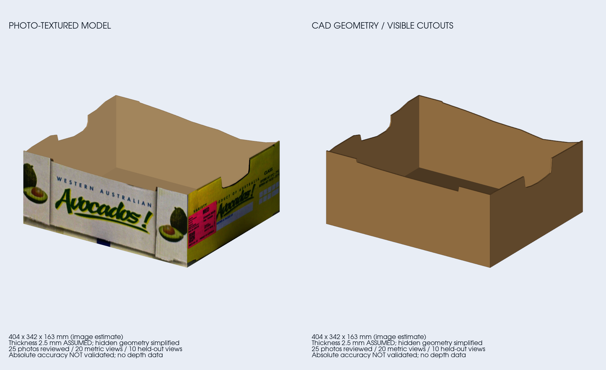

# Offenen Avocado-Karton aus dem Vierarm-Scan rekonstruieren

Stand13.11.2026: erster **assistierter, bildbasierter CAD-Entwurf**, ungefähr
**404×342×163mm**. Boden, vier Wände und die sichtbaren Griff-/Oberkantenausschnitte
sind modelliert. Die Außenflächen tragen auf Wunsch die fotografierte Bedruckung.
Die Maße sind Schätzungen; **keine metrische Qualitätsfreigabe** und kein Nachweis
einer Genauigkeit im Millimeterbereich.



## Dateien und Bedienung

Arbeitsordner: `$UWA_WS/setup/digitization/carton_multiview_20261113/`.
Keine neuen Fotos, Tiefendaten, Armbewegungen, Dienstneustarts oder globalen
Kalibrier-/TF-Änderungen. Die Kameras bleiben für diese Offlinearbeit unbenutzt.

| Datei | Inhalt / Einheiten |
|---|---|
| `cad/carton.step` | zusammenhängender CAD-Körper, **mm** |
| `cad/carton.stl` | geschlossenes Dreiecksmesh, **m**, z.B. für ROS/Gazebo |
| `cad/carton_textured.glb` | derselbe Körper mit Foto-Außenflächen, **m**, +Z oben |
| `cad/carton.scad` | editierbare Maße, Stärke und normierte Wandkonturen, **mm** |
| `carton_preview.png` | Vorschau mit Fototextur und reiner CAD-Geometrie |
| `carton_model.json` | Geometrie, Board-/Objektpose, Konturen und Einschränkungen |
| `refined_result.json`, `verification.json` | Fit-/Prüfresiduen und Nachweise |
| `r*_refined.jpg` | grüne Modellkanten / rote zugeordnete Bildpunkte |
| `*_profile.jpg` | entzerrte Wandbilder mit vereinfachter Kontur in Rot |
| `provenance.json`, `camera_models.json` | Quellenhashes, native Optik und Boardmessungen |

STEP und STL enthalten Geometrie, keine Fototextur. Eine automatische Einfügung
als vermessenes Kollisionsobjekt oder Welt-/TF-Anker ist damit nicht verbunden.

## Bildauswertung und Maßstab

Quelle ist `setup/digitization/four_arm_scan_20261113/scan_dataset.json`:
25native Originalfotos, Bild-/Record-Hashes, Kameraidentität, manueller Fokus
und Bildgröße geprüft. 20Wristfotos2592×1944, fünf OAK-Fotos8000×6000.
Die feste OAK wiederholt denselben Standort; 25Fotos sind21Standorte.

Für jede physische Kamera werden ihre eigenen nativen K/D bei passendem Fokus
eingefroren. LF245, LR406/result_v2, RF435/evaluation_v1, RR388/result_v1,
OAK116/Factory-Rational14. Die bislang separat gehaltenen HD-Intrinsics werden
**nur datensatzlokal** verwendet. RFs ursprüngliches `passed:false` und die
ausdrückliche frühere Nutzerübernahme bleiben sichtbar; OAK verwendet eine
Werksreferenz, keine hier neu validierte Intrinsicskalibrierung.

Das rechte40mm-ChArUco-Board ist direkt in allen Kameras sichtbar; bei Bedarf
werden seine bekannten ArUco-Markerecken verwendet. Die OAK sieht das linke
Board wegen des Kartons nicht ausreichend. Deshalb gibt es hier **keine
angenommene OAK-Überbrückung beider Boards**. Die nutzbaren Wristbilder sehen
beide Boards; deren relative Lage wird gemeinsam aus den Trainingsfotos
geschätzt. Nominale Tischabstände, Roboter-FK und Hand-Auge-Matrizen gehen nicht
in die Rekonstruktion ein. Papiermaßstab und Auflageebene bleiben Annahmen.

**Links vorne bleibt metrisch ausgeschlossen.** Trotz passender Identität,
Auflösung und Fokus sind Boardpose und Kartongröße widersprüchlich:
Runde1 Board-RMS3,59px rechts /8,74px links; sein separater Kartonfit liefert
ca.370×299×136mm. Die anderen Einzelkamerafits liegen ungefähr bei
397–432×319–357×158–165mm. Verzeichnungsextrapolation, Referenzpose und
Bildschärfe sind mögliche Ursachen; eine eindeutige Ursache ist nicht bewiesen.
Das bestehende Kalibrierergebnis wird weder verändert noch pauschal für ungültig
erklärt. Alle fünf LF-Fotos bleiben als Sichtprüfung und Diagnose erhalten.

## Fit, Prüfbilder und Formdetails

Explizite Eckpunktzuordnung in `landmark_seeds.json`; Pyramiden-LK überträgt
diese in die weiteren Runden, Vorwärts-/Rückwärtsprüfung maximal1,5px bei1600px
Vergleichsbreite. Fehlgeschlagene Tracks werden verworfen, Originale nie rotiert.
Vorschau-Rotation der ersten drei Wrist-Kameras wird auf Rohpixel zurückgerechnet.

Robuste gemeinsame Optimierung von rechteckiger Kartonhülle, Kameraposen und
Boardrelation bei **festen Intrinsics**. Boardpunkte und Objektpunkte haben
getrennte Residuen/Gewichte. Zehn Trainingsfotos: LR/RF/RR in Runden1/3/5,
OAK nur Runde1. Zehn Prüffotos: sechs neue Wriststellungen in Runden2/4 sowie
vier zeitliche OAK-Wiederholungen; diese vier sind keine neuen Perspektiven.
Prüfkameraposen werden ausschließlich aus den Boards bestimmt, ohne ihre
Karton-Eckpunkte zum Fit zu verwenden.

| Vergleich, jeweils1600px Bildbreite | Training | zurückgehaltene Prüfung |
|---|---:|---:|
| Fotos / gültige Eckpunkte |10 /66 |10 /62 |
| Median des Punkt-RMS jeFoto |14,05px |13,68px |
| Bereich des Punkt-RMS jeFoto |10,21–19,87px |11,17–19,11px |

Diese verbleibenden Abweichungen sind sichtbar und zu groß für behauptete
Millimetergenauigkeit. Kalibrier-/Boardfehler, Pappverformung, vereinfachte
rechte Winkel und assistierte Eckpunktwahl sind noch nicht getrennt bestimmt.

Oberkanten werden proWand in einem Trainingsfoto nachgezeichnet und mit der
angepassten Wandebene geschnitten. Endpunkte auf die rechteckige Hülle normiert,
Höhen auf deren Bereich begrenzt; kleine Pixelrückläufe zu senkrechten Kanten
zusammengezogen. **Kein unabhängiger Mehransichtsnachweis dieser feinen Konturen.**
Wand/Bodenstärke2,5mm angenommen. Unterseite, Wellpappenstruktur, Klammern,
Faltungen und zusätzliche Eckverstärkungsschichten nicht vermessen/modelliert.
Innenflächen/Unterseite bleiben ohne erfundene Fototexturen.

## Nachweise und Wiederholen

- STEP rückimportiert:404,04×342,33×163,31mm; Einheiten-/Ausdehnungsprüfung.
- STL292Dreiecke, geschlossen, konsistente Orientierung, ein verbundenes
  Volumen; GLB-Ausdehnung nach Rückimport identisch. Vorschau visuell geprüft.
- Rechtshändige Objektpose und Eckpunkt-Transformationsrichtung geprüft.
  Rückprojektion der unnormierten Kontur-Strahlschnitte besser als1e-4px.
- Alle zurückgehaltenen Objektpixel testweise um100/70px verschoben:
  **keine Änderung der sechs Fitparameter**, Nachweis in verification.json.
- Keine reale Kontrollmessung vorhanden; `measured_accuracy_validated:false`.

Offline aus dem Workspace, nachdem die gespeicherten Zuordnungen geprüft sind:

```bash
source src/multi_arm_manipulation_UWA/scripts/control_env.bash
RECON=setup/digitization/carton_multiview_20261113
TOOL=src/multi_arm_manipulation_UWA/tools/reconstruct_carton_scan.py
python3 "$TOOL" prepare --dataset setup/digitization/four_arm_scan_20261113/scan_dataset.json --output "$RECON"
python3 "$TOOL" track --output "$RECON"
python3 "$TOOL" fit --output "$RECON"
python3 "$TOOL" refine --output "$RECON"
python3 "$TOOL" contours --output "$RECON"
.venvs/oak-model/bin/python src/multi_arm_manipulation_UWA/tools/export_scanned_carton.py --model "$RECON/carton_model.json" --output "$RECON/cad"
.venvs/oak-model/bin/python src/multi_arm_manipulation_UWA/tools/preview_scanned_carton.py --directory "$RECON"
```

Die datensatzspezifischen Kalibrierquellen und ursprüngliche OAK-Grobschätzung
werden zur Initialisierung benötigt. Originale/Zuordnungen/Sitzungen bleiben
lokal unter setup. Keine neuen Abhängigkeiten installiert. Technische Grundlage:
[OpenCV-Projektion, Verzeichnung und PnP](https://docs.opencv.org/4.13.0/d9/d0c/group__calib3d.html).
