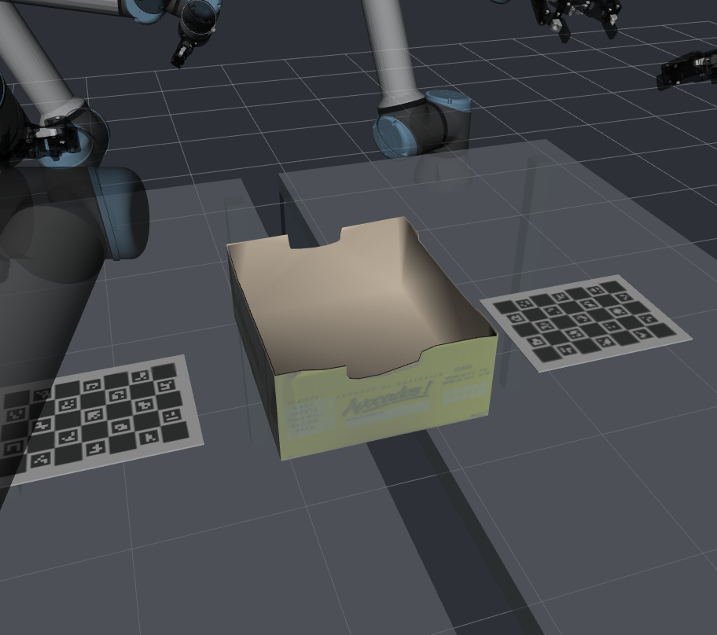

# Rekonstruierter Karton als Asset in der virtuellen Zelle

Seit13.11.2026 ist der texturierte Avocado-Karton als versioniertes Asset
**`carton_avocado_v1`** im Paket `uwa_cell_description` abgelegt. Er wird beim
normalen Zellstart automatisch als separates statisches Visual eingefügt.
Gazebo und RViz verwenden dieselbe Geometrie, Texturen und Objektpose.



## Asset und Pose

Verzeichnis: `uwa_cell_description/assets/carton_avocado_v1/`.
`asset.json` beschreibt Maße, Einheiten, Achsen, Herkunft, Referenzpose,
Qualitätsstatus und SHA256 aller Dateien. `carton.dae` und vier relative JPEGs
funktionieren in beiden Renderern; GLB, STL und STEP bleiben zusätzlich erhalten.
Geometrie/GLB/STL inMetern, STEP inMillimetern; Objektachsen rechtshändig,+Zoben.

Die zentrale Instanz steht unter `scene_objects` in
`uwa_cell_description/config/cell_layout.yaml`. Ihre Lage stammt direkt aus
`T_right_board_object` der [Bildrekonstruktion](carton_multiview_2026-11-13.md):

`T_world_object = T_world_right_table_top · T_table_board · T_board_object`.

Damit liegt der Karton mittig zwischen den Tischen, mit dem unteren Mittelpunkt
ungefähr bei**(-0,013;0,007;0,903)m**. Seine Unterkante folgt der konfigurierten
Boardebene; diese liegt im Modell3mm über der nominellen Tischplatte. Bei der
aktuellen Konfiguration ist der Objektursprung(0,157;-0,196;0,903)m, Yaw89,64°.
Tisch-/Boardänderungen werden beim Neuladen neu ausgewertet, ohne eine zweite
Weltpose von Hand nachzuführen. Die vorläufige Welt-/Boardzuordnung wird dadurch
**nicht** zu einer neu vermessenen Registrierung.

Das Modell bleibt eine Näherung von ca.404×342×163mm mit angenommener Stärke
2,5mm. Die Qualitätsgrenzen der Rekonstruktion bleiben im Manifest sichtbar.

## Starten und neu laden

Beim nächsten normalen `cell.sh start` wird der Asset-Prozess nach dem Zellspawn
gestartet. Eine bereits laufende Zelle kann ohne Neustart ergänzt werden:

```bash
bash src/multi_arm_manipulation_UWA/scripts/cell.sh assets
```

RViz öffnen: `bash src/multi_arm_manipulation_UWA/scripts/cell.sh rviz`.
Die Anzeige heißt **Reconstructed objects - photo textures (approximate)** und
verwendet `/uwa_cell/scene_assets/markers`, eingebettete Materialien eingeschaltet.
Der zusätzliche TF-Frame heißt `asset/avocado_carton`.

Nach einer Änderung der zentralen Szene:

```bash
source src/multi_arm_manipulation_UWA/scripts/env.bash
ros2 service call /uwa_cell/scene_assets/reload std_srvs/srv/Trigger '{}'
```

`enabled:false` plus Reload blendet die Instanz aus. Für eine ausdrücklich andere
Position sind `anchor_frame` und ein eigenes rechtshändiges4×4-`T_anchor_object`
möglich; ein Ankerwechsel ohne explizite neue Matrix wird abgewiesen. Bei
normaler Zellabschaltung wird auch der separat gestartete Asset-Dienst beendet.
Ein Nutzungsschloss verhindert doppelte Modellbesitzer. Marker laufen nach
Dienstverlust innerhalb6s ab; nur die eigenen Modellnamen `uwa_asset_*` werden
angefasst. Reload validiert sämtliche Dateien/Posen vor der Modelländerung.

## Visualisierung und Kollisionsplanung

Die Instanz ist zunächst **visual-only**, wie im Arbeitsstatus vor Umsetzung
festgehalten. Sie hat keine Gazebo-Kollision, verändert MoveIt-Hindernisse nicht
und greift weder auf Controller noch auf echte Kameras/Roboter zu. Dadurch wird
der bereits laufende Bahnplanungsvergleich nicht durch ein neues Hindernis
verändert. Für spätere Handhabungsplanung muss bewusst eine passende
Kollisionsgeometrie, Objektmasse und Greifaufgabe ergänzt werden; eine sichtbare
Schachtel ist keine automatisch bekannte Planungsgeometrie.

## Nachweise

- Beide Pakete gebaut;17gezielte Offlineprüfungen für Asset/Board/OAK bestanden.
  Maßstab/Ausdehnung/292Dreiecke, relative Texturen, Hashfehler, gedrehte
  Tisch-/Boardanker, starre Transformationen, kollisionsloses SDF und beide
  Varianten von Symlink-Installationen geprüft.
- Laufender Gazebo-Server beibehalten: derselbe Zell-Prozess, kein Reset oder
  Armkommando. Modell `uwa_asset_avocado_carton` erfolgreich eingefügt; Gazebo-
  Modellpose, ROS-TF und Markerposition stimmen numerisch überein.
- RViz mit aktualisierter Anzeige geöffnet, Marker empfangen, keine gemeldeten
  Texturladefehler. Direkter RViz-Renderexport `rviz-render.png` visuell geprüft:
  Fototextur, offene Form und Platzierung zwischen beiden Boards sichtbar.
  Der zunächst schwarze Desktop-Screenshot wurde dafür nicht als Nachweis benutzt.
  Livebericht und Quellcode des einmaligen Renderprüfers:
  `setup/digitization/carton_multiview_20261113/scene-live/report.json`.
- Die OAK-Simulationskamera war für den parallelen Replay nicht in der Szene.
  Deren Einstellungen wurden erhalten; der Livecheck dokumentiert deshalb
  ausdrücklich `rendered_camera_checked:false`, keine behauptete Bildprüfung.

Erneut paketieren aus der unveränderten lokalen Rekonstruktion:

```bash
.venvs/oak-model/bin/python src/multi_arm_manipulation_UWA/tools/package_carton_asset.py \
  --source setup/digitization/carton_multiview_20261113 \
  --output src/multi_arm_manipulation_UWA/uwa_cell_description/assets/carton_avocado_v1
```

Das Asset enthält die abgeleiteten Modell-/Texturdateien, keine Rohaufnahmen,
Zugangsdaten oder vollständigen Kamerasitzungen. Das portable COLLADA-Format
folgt der [Gazebo-Empfehlung für visuelle Meshes](https://gazebosim.org/api/sim/8/model_and_optimize_meshes.html).
