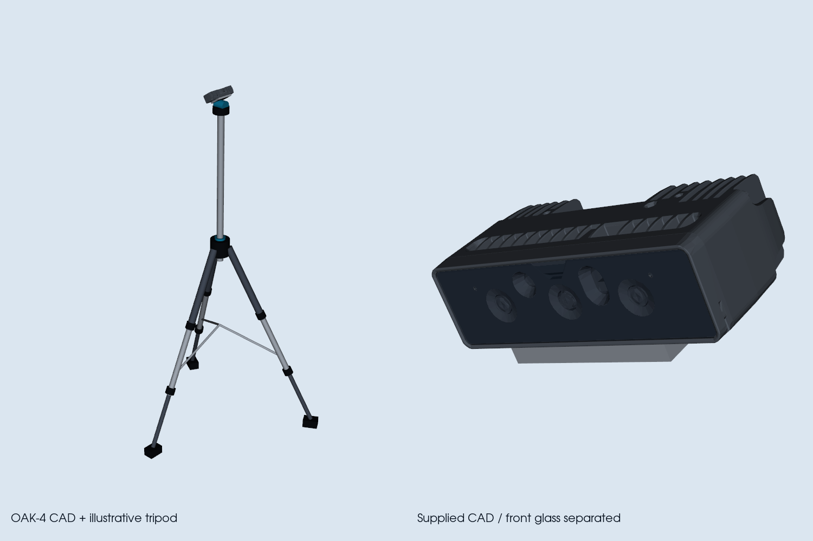

# OAK-4-CAD und Stativ in Gazebo und RViz

Seit12.11.2026 verwendet die Übersichtskamera das vom Nutzer bereitgestellte
Modell aus `~/Downloads/oak4-pro-3d-model.zip`. Die enthaltene Datei
`oak4 enclosure-thermal 30.STEP` ersetzt das bisherige primitive Gehäuse.
Dasselbe Modell und ein selbst erstelltes Fotostativ werden in Gazebo und
als ROS-Marker in RViz angezeigt.



Die Abbildung ist eine separate Modellvorschau, kein Screenshot der realen Zelle.

## Umsetzung

- Millimeter aus dem STEP-Modell wurden in Meter umgerechnet. Das Gehäuse ist
  ungefähr143,5mm breit,42,5mm hoch und67,2mm tief.
- Die komplette Baugruppe enthält1669 Volumenkörper und viele Elektronikdetails.
  Die Darstellung wurde von623418 auf52169 Dreiecke reduziert; die beiden
  binärenSTL-Dateien benötigen zusammen2,61MB. Das117MB-STEP bleibt lokal unter
  `setup/models/oak4-pro/` und wird nicht eingecheckt.
- Die vorderen Scheiben sind ein separates, durchsichtig dargestelltes Mesh,
  damit die dahinter liegenden Optiken erkennbar bleiben. Farben/Transparenz sind
  für diese Visualisierung gewählt, keine Herstellertexturen.
- Das eigene Stativ hat drei schräge Teleskopbeine, Klemmen, Gummifüße,
  Spreizstreben, Mittelsäule, Schwenkkopf und Schnellwechselplatte. Die Füße
  bleiben auf der Bodenebene, auch wenn die Kamera nach unten geneigt ist.
  Die Höhe folgt der tatsächlichen konfigurierten/übernommenen Kamerapose.
- Gazebo und RViz verwenden dieselben Geometrien und Transformationen. Der
  RViz-Publisher unterstützt jetzt Mesh-, Zylinder- und Box-Marker.

Meshes und Herkunft:
`uwa_cell_description/meshes/visual/oak4_pro/{oak4_pro.stl,oak4_pro_glass.stl,provenance.json}`.
Die Provenienz enthält SHA256 der STEP-Datei und der Meshes, Einheiten,
Reduktionsparameter, Koordinatenkonventionen und Boundingboxen.

## Optik und Grenzen

Das Mesh verwendet +X als Blickrichtung,+Y nach links,+Z nach oben, passend zum
Gazebo-Sensorframe. Im Quell-CAD entspricht das +Z/−X/−Y. Der visuelle Anker liegt
bei CAD[0,0,32,5]mm vor der Frontscheibe. Die genaue Zuordnung des echten optischen
Eintrittspunkts zum Gehäuse ist **nicht vermessen**. Sie wird als visuelle Näherung
geführt und ändert keine bestehende optische Kalibriertransformation.

Die vorläufig akzeptierte OAK-Pose aus dem aktiven Kalibrierprofil bleibt erhalten;
auch Intrinsics, Bildauflösung und Blickrichtung werden durch das CAD nicht geändert.
Die Modellrevision aus dem gelieferten Archiv ist kein Nachweis der exakten
Gehäuserevision des angeschlossenen Geräts.

Das Stativ ist eine lokale illustrative Konstruktion, kein vermessenes Modell
des vorhandenen Stativs. Kamera/Stativ bleiben wie zuvor **Visual-Geometrie**
der separaten statischen Übersichtsentität. Es wurden keine neuen MoveIt-
Kollisionskörper oder physikalischen Kontaktkörper hinzugefügt.

## Verwendung

Neue Simulationsstarts laden die Darstellung automatisch. In einer bestehenden
Zelle reicht nach einer reinen Modell-/Konfigurationsänderung normalerweise:

```bash
bash src/multi_arm_manipulation_UWA/scripts/overview.sh reload
```

Bei Python-Codeänderungen den **Übersichtsdienst allein** neu starten, damit die
neuen Funktionen geladen werden. Bei dieser Integration wurde ausschließlich
`uwa-cell-overview.service` neu gestartet; Zelle, RViz und Hardwaretreiber blieben
laufen. ROS-Marker: `/uwa_cell/oak_overview/markers`, Domain64,TransientLocal.
Die bestehende RViz-Konfiguration abonniert diesen Topic bereits.

## Konvertierung erneut ausführen

Normaler Betrieb benötigt keine CAD-Bibliothek. Für eine erneute Konvertierung
steht `tools/convert_oak4_cad.py` bereit; verwendet wurden isoliert
cadquery-ocp8.0.1.1.0 und vtk9.6.2 unter `$UWA_WS/.venvs/oak-model`.
Beispiel aus dem Workspace mit dem lokal entpackten Original:

```bash
.venvs/oak-model/bin/python src/multi_arm_manipulation_UWA/tools/convert_oak4_cad.py \
  --step setup/models/oak4-pro/oak4-pro-original.step \
  --work-dir setup/models/oak4-pro/rebuild \
  --output src/multi_arm_manipulation_UWA/uwa_cell_description/meshes/visual/oak4_pro
```

Danach `uwa_cell_description` und `uwa_cell_gazebo` in dieLyrical-Installation
bauen. Die Konvertierung benötigt keinen Zugriff auf eine physische Kamera.

## Prüfnachweise

21 gezielte Tests bestanden: native STL-Metermaße/Hashes, Gehäuse hinter dem
Sensor, identische Gazebo-/RViz-Posen und Geometrien, Bodenauflage des Stativs,
unveränderte optische Transformation sowie bestehende OAK-Registrierungsprüfungen.
Zwei Lyrical-Pakete gebaut.

Liveprüfung der laufenden Zelle: zwei CAD-Meshes und27 Stativvisuals in der
Gazebo-Scene;32 RViz-Marker einschließlich Frustum/Status/DELETEALL, bestehender
RViz-Abonnent bestätigt. Frische4000×3000-Bilder, fortschreitende Simulationszeit,
K/D und beide optischen TFs passend zum aktivenProfil. Alle neun Controller aktiv;
maximale Gelenkänderung während des Kamera-Neuladens0,00001064rad.
Die separate VTK-Modellvorschau wurde visuell geprüft. NativeFensteraufnahmen
lieferten schwarze Bilder und wurden nicht als sichtbarerRendernachweis gewertet.

Nachweise lokal: `setup/models/oak4-pro/live/report.json`, `scene.txt`,
`simulated-overview.jpg` und `setup/logs/uwa-oak-cad-{build,tests,live}.log`.
Keine Hardwarekamera geöffnet, keine Hardware-/Roboterkommandos gesendet.
