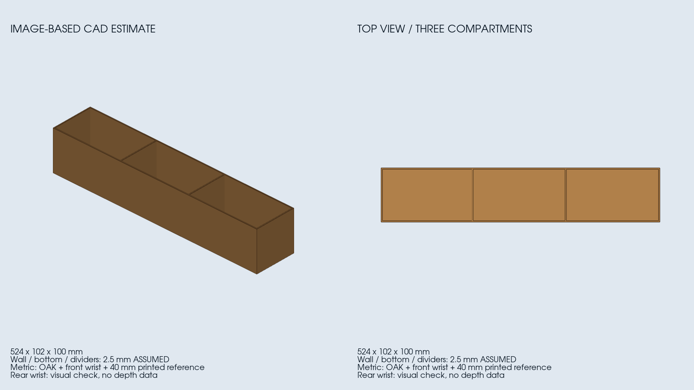

# Einfache Objekte aus Farbbildern digitalisieren

Erste Version vom12.11.2026: **assistierte, parametrische Rekonstruktion eines
rechteckigen offenen Kartons**. Fotos werden automatisch aufgenommen und eine
Geometrie wird numerisch angepasst; die Zuordnung der Objekt-Eckpunkte bleibt
explizit und wird vom Assistenten oder einem Menschen geprüft. Es ist noch kein
allgemeiner automatischer3D-Scanner für beliebige Oberflächen.



## Ergebnis am echten Karton

Drei neue Farbbilder: OAK8000×6000, Front-/Rear-Wrist jeweils2592×1944. Aus den
Fotos entstand eine offene Schachtel mit Boden, vier Außenwänden und zwei
Trennwänden. Keine Tiefenaufnahme, keine Robotermotion, keine Simulation geändert.

| Parameter | Ergebnis | Herkunft |
|---|---:|---|
| Außenlänge | ca.524mm | geometrischer Bildfit |
| Außenbreite | ca.102mm | geometrischer Bildfit |
| Außenhöhe | ca.100mm | geometrischer Bildfit |
| Erste Trennwand | ca.172mm ab Längsanfang | sichtbare Oberkanten in beiden Messbildern |
| Zweite Trennwand | ca.347mm ab Längsanfang | sichtbare Oberkanten in beiden Messbildern |
| Wand/Boden/Trennwandstärke |2,5mm | **angenommen**, imCAD editierbar |

CAD-Dateien lokal:
`$UWA_WS/setup/digitization/carton_20261112/result_v1/cad/`

- `carton.step`: geprüfter zusammenhängender CAD-Körper, Einheitenmm.
- `carton.stl`: geschlossenes Mesh, Einheitenm fürROS/Gazebo.
- `carton.scad`: editierbare Parameter für Maße/Wandstärke/Trennwandpositionen,mm.
- `export.json`: Dateihashes, STEP-Rückimportmaße und rechtshändige Objektpose.

Die Maßzahlen sind **Bildschätzungen**, keine bestätigte Messgenauigkeit.
Eine Gegenmessung am realen Karton steht aus. Faltungen, Klammern, Etiketten,
Wellpappenstruktur und unregelmäßige Wandverformungen sind nicht rekonstruiert.

## Maßstab und Kameras

Metrische Referenz ist das in den Fotos sichtbare rechte Tischboard:7×5Felder,
40mm-Kanten,DICT_4X4_100/IDs50–66. Der Druckmaßstab wird als korrekt vorausgesetzt.
Da der Karton große Teile des Musters verdeckt und verbleibende Schachbrettecken
teilweise kollinear sind, werden automatisch auch sichtbare ArUco-Markerecken
mit ihren bekannten Boardkoordinaten verwendet.

- **OAK:** Factory-K/D mit allen14 Verzeichnungswerten bei8K/Fokus116; fünf
  sichtbare Marker liefern20Referenzpunkte, lokaler Boardfit2,58nativePixelRMS.
- **Front-Wrist:** übernommene2592×1944-Intrinsics/Fokus435; sieben Marker liefern
  28Referenzpunkte, Boardfit1,11nativePixelRMS. Deren ursprüngliche automatische
  Intrinsics-Qualitätsgrenze wurde nicht bestanden; diese Einschränkung bleibt.
- **Rear-Wrist:** Bild aufgenommen und zur visuellen Prüfung der drei Fächer
  genutzt. Zum Aufnahmezeitpunkt fehlen passende validierteHD388-Intrinsics im
  aktiven Profil; deshalb wird es **nicht metrisch mit falschen VGA-K/D verrechnet**.

Die Kamera-zu-Board-Pose wird für jedes Messfoto neu aus seinen Bildpunkten
bestimmt. **Roboter-FK, Hand-Auge-Extrinsics und vorläufige OAK-Weltregistrierung
gehen nicht in den Geometriefit ein.** Zwischenzeitlich anders stehende Arme
benötigen damit keine angenommenen alten Kameraposen. Referenz und Objekt müssen
während der zeitlich nicht synchronisierten Fotos starr bleiben.

Die Aufnahme meldete `all_captured:true`. Ihr mobilesA4-Board-Kriterium
`all_usable:false` ist hier kein Fotoausfall: Für dieses Objekt wird das rechte
Tischboard verwendet. Die CLI fand keine vollständigen zeitlich passenden
ROS-Gelenkdaten; es werden keine gemessenen Roboterstellungen behauptet.

## Reproduzierbare Pipeline

1. Über die bestehende Drei-Kamera-Routine nativeFotos aufnehmen und Originale,
   Fokus/Identität/Wiederherstellung sowie Aufnahmefenster speichern.
2. Bilder/Hash und passende Intrinsics prüfen. Boardpose jeFoto mit OpenCV-PnP
   schätzen, unverwendbare Kameras ausdrücklich als reine Sichtprüfung markieren.
3. Zugeordnete Außen-Eckpunkte in `landmarks.json` markieren. Im Erstversuch
   sechs Punkte jeMessbild, darunter vier obere Randecken und zwei Auflageecken.
4. Lage, Drehung, Länge, Breite und Höhe gemeinsam robust anpassen. Annahmen:
   rechte Winkel, parallele Außenwände, senkrechte Wände, Boden auf Boardebene.
   Die Trennwandpositionen werden anschließend an ihren Oberkanten angepasst.
5. Projektion zurück in die Fotos, Residuen und Annotationsempfindlichkeit
   speichern; anschließend STEP/STL/SCAD erzeugen und Geometrie prüfen.

Das neue Werkzeug `uwa_cell_control.object_digitization` sendet selbst keine
Kamera-, ROS- oder Roboterschreibbefehle. Es verarbeitet gespeicherte Daten.
Die separate existierende Aufnahmeroutine steuert ausschließlich die Kameras.
Die Posekonvention folgt [OpenCV-PnP](https://docs.opencv.org/4.10.0/d5/d1f/calib3d_solvePnP.html).

### Aufrufen aus dem Workspace

```bash
# Alle Kameras müssen für diese Aufnahme frei sein; keine fremde Reihe stoppen.
bash src/multi_arm_manipulation_UWA/scripts/camera_capture.sh --capture-only \
  --output "$UWA_WS/setup/digitization/NEUES_OBJEKT/acquisition"

source src/multi_arm_manipulation_UWA/scripts/control_env.bash
# CAPTURE_SET bezeichnet den konkreten set_<Zeit>-Ordner mit manifest.json.
ros2 run uwa_cell_control digitize_box \
  --capture-set /absolut/zum/CAPTURE_SET --output /absolut/zum/prepared

# Eckpunkte explizit zuordnen; bestehendes Beispiel im ersten Datensatz ansehen.
ros2 run uwa_cell_control digitize_box \
  --cameras /absolut/zum/prepared/camera_models.json \
  --landmarks /absolut/zur/landmarks.json --output /absolut/zum/result_v1

.venvs/oak-model/bin/python src/multi_arm_manipulation_UWA/tools/export_digitized_tray.py \
  --result /absolut/zum/result_v1/reconstruction.json \
  --output /absolut/zum/result_v1/cad

python3 src/multi_arm_manipulation_UWA/tools/preview_digitized_tray.py \
  --result-dir /absolut/zum/result_v1
```

Der CAD-Export nutzt die bestehende isolierte CAD-Umgebung mit OpenCascade/
trimesh. Die Vorschau benötigtVTK. Kameraauswertung verwendet vorhandenesOpenCV/
SciPy. InstallierterCLI-Einstieg nach Build von `uwa_cell_control`.

`prepare` friert K/D und Bild-Board-Posen unter `camera_models.json` ein. Bei
geändertem Profilhash gegenüber dem Aufnahmezeitpunkt wird eine neue Vorbereitung
abgelehnt; bestehende vorbereitete Datensätze bleiben unabhängig offline nutzbar.
Es findet keine Kalibrieroptimierung oder Profilaktivierung statt.

### Eckpunktformat und Koordinaten

`landmarks.json` enthält `proxy_width` (im Beispiel1800), `metric_cameras` und je
Kamera `observations.<name>.ids`/`pixels`. Pixel beziehen sich auf das ganze Bild
bei der genannten Breite, mit unverändertem Seitenverhältnis. Die Software
projiziert mit dem nativenK und skaliert erst zum Vergleich in diese Koordinaten.

Objektpunkte0–3 sind die vier unteren Rechteckecken in Umlaufrichtung,
4–7 die zugehörigen oberen Punkte. Mindestens die Auflageecken2/3 müssen im
Referenzbild verfügbar sein. `dividers` enthält die Bildkoordinaten der beiden
oberen Endpunkte jeder Trennwand. Das Beispiel liegt unter
`setup/digitization/carton_20261112/landmarks.json`.

Der Boardframe ist OpenCV(+Z in die Platte). Der exportierte lokaleCAD-Frame
ist **rechtshändig mit +Z nach oben**, Ursprung an der unteren Ecke3.
`T_right_board_object` in `export.json` beschreibt die Zuordnung. Daraus wird
kein vermessener Welt-/Tischanker und kein automatisches Kollisionsobjekt gemacht.

## Prüfergebnisse und Genauigkeitsgrenzen

Der finale Fit benutzt alle zwölf Außenpunkte; seine Residuen sind **keine
unabhängige Validierung**. Bei1800Pixel Vergleichsbreite: OAK5,41px undFront6,60px
Punkt-RMS; in den nativenBildern24,04px bzw.9,51px. Die Overlays zeigen grüne
Modellkanten und rote gewählte Punkte. Die reale Schachtel ist nicht ideal starr
oder exakt rechtwinklig; idealisierte Geometrie und Auswahlfehler bleiben sichtbar.

Einzelbild-Fits ergeben ungefähr531×106×96mm (OAK) und526×102×98mm (Front).
Diese Unterschiede sind ein Diagnosehinweis, kein statistisches Genauigkeitsmaß.
Bei80 Wiederholungen mit künstlichem2-Pixel-Annotationsrauschen liegen die
5–95%-Bereiche ungefähr522–526mm/101–103mm/98–101mm. Diese Variation berücksichtigt
**nur die Annotation**, weder systematische Kalibrier-/Druck-/Supportfehler noch
Modellvereinfachung und ist deshalb **kein absolutes Konfidenzintervall**.

Sechs synthetische Tests bestanden: unbekannte Boxpose/-maße, Ausreißer,
fehlende Intrinsics/degenerierte Kamerabasis, Auflösungsinvarianz, rechtshändige
Exporttransformation und nicht überlappende Wand-/Trennwandkörper.
Das echteSTEP wurde wieder eingelesen und seine Maße geprüft. STL ist geschlossen
(watertight); Maße stimmen inMeter mit dem STEP überein. CAD-Vorschau visuell
geprüft. Keine Hardwarefahrt, keine Tiefenaufnahme oder aktive Profiländerung.

Daten: `setup/digitization/carton_20261112/` mit Originalfotos, Referenzpunkten,
Modellen, Overlays, Sensitivität, CAD und SHA256-Manifest. Fotos/Sitzungen bleiben
außerhalbGit. Logs: `setup/logs/uwa-carton-{three-camera-capture,preparation,
reconstruction,cad-export,cad-preview,tests,build}.log`.
