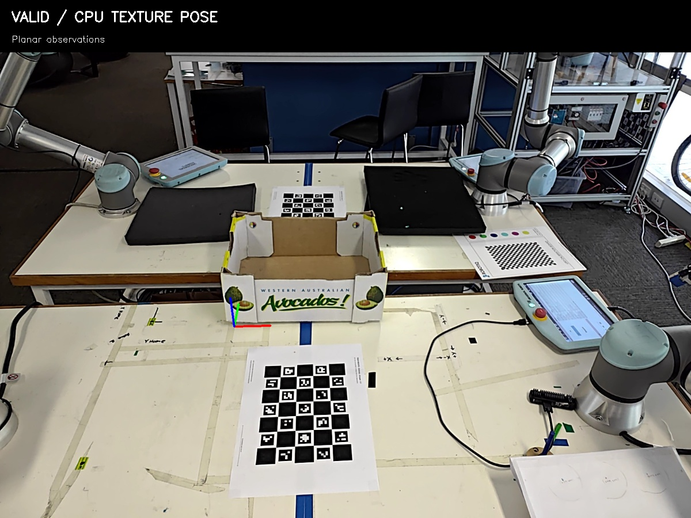

# Objektpose: statisch lokalisieren und dynamisch verfolgen

Stand13.11.2026: erster **CPU-Prototyp** für bekannte, texturierte Assets.
Zwei Modi teilen dieselbe Objekt-ID und denselben metrischen Assetframe:

| Modus | Ablauf | Zweck |
|---|---|---|
| Static localization | mindestens drei frische Bilder, globale Wiedererkennung jeBild, Konsistenzprüfung und robuster gemeinsamer Bildpunktfit | ruhende Kamera/Objekt vor Manipulation |
| Dynamic tracking | globale Initialisierung, anschließend pyramidenförmiger Optical Flow und robuste6D-Pose; bei Verlust neu lokalisieren | schnelle fortlaufende Kamerapose |

Das ist **keine FoundationPose-Installation**. Der erste Backend verwendet
OpenCV-SIFT, metrische Oberflächenmerkmale, RANSAC/PnP und LK-Tracking.
FoundationPose benötigt in der offiziellen Implementierung CUDA und RGB-D
einschließlich Objektmaske zur Initialisierung. Als spätere Backends kommen
[FoundationPose](https://github.com/NVlabs/FoundationPose) auf zusätzlichem
NVIDIA-Rechner und [M3T](https://github.com/DLR-RM/3DObjectTracking/tree/master/M3T)
mit Region-/Textur-/Tiefenmodalitäten infrage. Sie sind noch nicht angebunden.
Nutzerentscheidung: zunächst Mini-PC, zusätzliches GPU-Compute organisiert er
parallel; keine Anschaffung oder Remote-Anbindung durch diesen Prototyp.



## Benutzen

Das Paket `uwa_cell_tracking` ist nach `install_lyrical` gebaut. Aus dem Workspace:

```bash
# Explizit die echte OAK öffnen: Domain65/LOCALHOST, keine Roboteraktionen.
# Bereitet die Modellmerkmale beim ersten Mal automatisch vor.
bash src/multi_arm_manipulation_UWA/scripts/object_tracking.sh oak
```

Der Tracker startet **IDLE**. In einem zweiten Terminal:

```bash
# Einmalige statische Messung; Kamera UND Karton müssen stillstehen.
bash src/multi_arm_manipulation_UWA/scripts/object_tracking.sh localize

# Laufende Verfolgung; nach Verlust erfolgt eine neue globale Initialisierung.
bash src/multi_arm_manipulation_UWA/scripts/object_tracking.sh track

# Bild mit Achsen und deutlich lesbarem Status anzeigen.
bash src/multi_arm_manipulation_UWA/scripts/object_tracking.sh view

# Poseberechnung stoppen; verwirft auch schon laufende alte Ergebnisse.
bash src/multi_arm_manipulation_UWA/scripts/object_tracking.sh stop
```

**Ctrl+C im ersten Terminal schließt die eigene Kamerapipeline** und gibt die
Fotolease frei. `stop` stoppt die Poseberechnung; der separat laufende Bildstream
kann für die Vorschau weitergenutzt werden. Während dieser Stream die OAK nutzt,
kann kein gleichzeitiger HQ-Fotoauftrag zugreifen. Fremde Kameranutzer werden
weder beendet noch übernommen; belegte Lease führt zu einem Fehler.

Andere eigene Assets: als zweites Argument z.B.`oak MEIN_ASSET_ID` beziehungsweise
`prepare MEIN_ASSET_ID`. Sie müssen als texturierte, metrische COLLADA-Assets
mit `asset.json` vorliegen. Wenig Textur/ähnliche Ansichten können die Erkennung
verhindern; hier wird kein universeller Scanner/Detektor behauptet.
Bei Assetänderung `prepare` erneut ausführen; Referenzen sind asset-hashgebunden.

Für eine bereits vorhandene ROS-Kamera ohne Gerätezugriff:

```bash
source src/multi_arm_manipulation_UWA/scripts/env.bash
ros2 launch uwa_cell_tracking tracking.launch.py \
  reference:="$UWA_WS/setup/tracking/models/carton_avocado_v1/reference.npz" \
  image_topic:=/MEINE_KAMERA/image_raw camera_info_topic:=/MEINE_KAMERA/camera_info \
  use_sim_time:=false
```

Die ROS-Domain muss zur Kamera passen. Der generische Launch startet keinen
Kameratreiber. `object_tracking.sh sim` verwendet die Sim-OAK-Topics/Domain64;
Bedienaufrufe dazu mit `UWA_TRACKING_DOMAIN=64`. Keine pausierten Simulations-
oder Hardwarefahrten werden durch Tracking wiederaufgenommen.

## Ausgabe und Gültigkeit

- `/uwa_tracking/object_tracker/pose`: `PoseStamped`, **T_camera_object**, Meter
  und Quaternion, Originalbild-Zeitstempel und optischer Kameraframe erhalten.
- `/uwa_tracking/object_tracker/status`: JSON mit VALID/LOST/AMBIGUOUS/STALE,
  Bildalter, Inliern, Pixel-RMS und Rechenzeit. `VALID` bedeutet bestandenes
  visuelles Konsenskriterium, **keine vermessene Genauigkeitsfreigabe**.
- `/uwa_tracking/object_tracker/overlay`: aktuellesBild mit Objektachsen/Status.
- Services `…/localize`, `…/start`, `…/stop`: `std_srvs/srv/Trigger`.
- Echte OAK: `/oak4/tracking/image_raw`, `camera_info`, `capture_status` auf65.

Kein Welt-/Roboter-TF wird aus einer gespeicherten Simulationspose erfunden.
Für eine Manipulation benötigt man zusätzlich eine geprüfte Transformation der
Kamera zur jeweiligen Roboterbasis zum richtigen Aufnahmezeitpunkt. Die
vorläufige OAK-Weltregistrierung und Modellgeometrie sind dafür noch keine
absolute Messreferenz. `manipulation_approved:false` und
`absolute_accuracy_validated:false` bleiben ausdrücklich in den Statusdaten.

Bei Verlust/Mehrdeutigkeit/zu alten Bildern wird **keine neue alte Pose**
veröffentlicht. Konsumenten müssen trotzdem Status und Posezeit prüfen, weil
eine bereits empfangene Pose-Nachricht bei ihnen gespeichert bleiben kann.
KameraInfo/Bildgröße/Frame müssen passen; Änderungen von K/D, zurückspringende
Zeit und zu große Bildlücken setzen die Verfolgung zurück. Latest-frame-Slot
verhindert eine anwachsende Bildwarteschlange. Die rechenintensive Arbeit läuft
getrennt vom ROS-Spin; Stop invalidiert laufende Ergebnisse durch Sitzungs-ID.

## Modell und Verfahren

Aus den vier Texturen des Kartonassets werden derzeit3266SIFT-Merkmale extrahiert.
UV-Dreiecke ordnen sie baryzentrisch echten3D-Oberflächenpunkten im Assetframe
zu. Geometrie/Dateihashes werden geprüft. **`reference_pose` des Assets,
ChArUco-Boardpose und bekannte Szenenlage werden zur Erkennung nicht eingelesen.**
Ein Test verändert die gespeicherte Referenzpose absichtlich massiv und bestätigt
unveränderte Merkmale/3D-Punkte. Referenzbank unter
`setup/tracking/models/carton_avocado_v1/reference.npz` plus Herkunfts-JSON.

Globaler Matcher mit Verhältnisprüfung, eindeutigen Zuordnungen und
Global-/Einzelflächen-Hypothesen. Ähnlich gute unterschiedliche Posen werden als
AMBIGUOUS verworfen. Anfangs mindestens24Inlier, Tracking mindestens16;
Ausreißer, geringe Punktverteilung und problematische planare Lösungen werden
geprüft. Der statische Modus verlangt verschiedene Bilddateien, konsistente
Posen und einen erfolgreichen robusten gemeinsamen Fit. Wiederholte identische
Pixelbilder werden nicht als drei unabhängige Messungen gezählt. Diese Prüfung
beweist trotzdem keine absolute Objekt-/Kameraruhe.

Dynamisch: Vorwärts-/Rückwärts-LK und PnP, standardmäßig maximal0,5s Bildlücke;
bei Fehler zurück zur Initialisierung. Ein rein geometrischer Featuretracker
kann bei starken Bewegungen, Verdeckung oder ähnlichen Etiketten driften oder
verlieren. M3T-/Tiefen-/Konturmodalitäten sollen später dagegen verglichen werden.

## OAK-Optik und Zeitskala

SDK weiterhin isoliert; vorhandener `oak4_board_preview.py` erhält opt-in
1600×1200/10fps, manuellen Fokus116, Ausgabe-K aus `ImgTransformation`, Factory-D
und SDK-Bildalter. Die bisherige GUI-Vorschau bleibt standardmäßig2000×1500/2fps.
Kein Flash-/Werkskalibrierungswechsel. Bild/JSON werden zusammen atomar abgelegt.

Der ROS-Header wird aus Host-Empfangszeit minus SDK-Bildalter abgeleitet;
Device-Zeit/Sequenz bleiben separat erhalten. Das ist **keine nachgewiesene
hardwareseitige Synchronisation mit den URs**. Beim späteren Einsatz bewegter
Wrist-Kameras muss deren zeitlich passende Pose gesondert abgesichert werden.
HQ-Tiefe ist aktuell in rektifizierter Mono-Perspektive und nicht automatisch
RGB-ausgerichtet; sie wird deshalb hier noch nicht ungeprüft hinzugemischt.

## Gemessener Stand und Grenzen

| Prüfung | Ergebnis |
|---|---|
| Kernel-/Referenztests |6PASS:6D-Richtung, Rauschen/Ausreißer, Degeneration, synthetische Bewegung, Verdeckung/Zeit/K-Wechsel, Poseprior-Unabhängigkeit/Hash, doppelte statische Bilder |
| ROS-Replay auf isolierter71 |PASS: statische/dynamische Ausgabe, Overlay, Bildausfall, Stop während laufender Berechnung |
| Echt-OAK-Lauf, ruhender Karton |188Frames, **10,012empfangeneFPS**,1600×1200/Fokus116 |
| Statisch im Livetest |VALID, ca.0,42px Reprojektions-RMS; Ergebnisalter1,39s |
| Online-Verfolgung |116VALID-Ausgaben in rund12s; **7,53ms** mediane Kernrechenzeit |
| SDK-Bildalter |maximal128ms im begrenzten Lauf; nicht gesamte Ende-zu-Ende-Latenz |
| Separate geometrische Streamprüfung |24Boardecken,0,256px Output-RMS; nicht als Poseprior benutzt |

Ein einzelner STALE-Status trat beim Wechsel nach längerer statischer Verarbeitung
auf; der Start setzt nun den Empfangs-Watchdog neu. Rechenzeiten enthalten weder
die Kameraübertragung noch sämtliche ROS-/Overlaykosten. Frühere Offlinewerte:
globale Initialisierung ca.0,3–0,5s,3-Frame-Static ca.1,4s; Verfolgung10msWrist
beziehungsweise46msbei gespeicherten8K-OAK-Bildern.

Der finale Bildtest gab OAK und Rear rechts frei; links hinten/vorne rechts
blieben LOST. Frühere Entwicklungshypothesen waren teils deutlich falsch, trotz
kleinem Pixel-RMS. Mehr Hypothesen/Flächenprüfung und strengere Mindeststützung
reduzieren das, beweisen aber keine allgemeine Fehlerrate. Die Bewertung wurde
an diesem Datensatz entwickelt; es ist kein unabhängiger Genauigkeitsbenchmark.
Abweichungen von0,6–1,6mm zu den alten Bild-Referenzposen sind **keine Ground-
Truth-Millimeterwerte**, denn Modell und Referenz stammen aus derselben
Rekonstruktion. Deren bekannte Mehransichtsfehler bleiben erhalten.

Der reale Karton wurde im Test **nicht bewegt**. Online-Empfang und Poseupdates
sind geprüft; reale Bewegung, Teilverdeckung, Wiederfinden nach Umsetzen und
unabhängige metrische Kontrollmessung stehen aus. Danach erst eine bewusste
Anbindung an Greifen/Manipulation. Die eigene OAK-Pipeline wurde nach dem Test
geschlossen und die Fotosperre frei bestätigt; keine Arm-/Programmaktion.

Nachweise: `setup/tracking/carton_cpu_20261113/` mit `evaluation.json`,
`ros_replay.json`, `live/report.json`, `live/camera_geometry_check.json` und
`live/overlay.jpg`. Rohdaten/Referenzbanken werden nicht eingecheckt.
