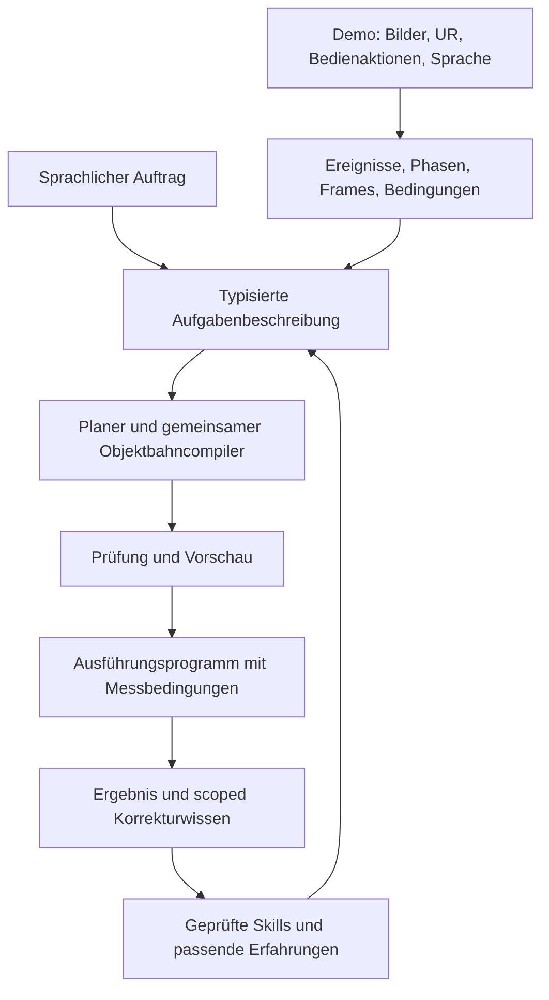

# MRS-Programmierpipeline: wenige Demonstrationen plus Sprache

Stand: 17.11.2026, Australia/Perth. Bestandsaufnahme und Literaturauswertung;
Architektur und Pilot unten sind Empfehlungen, noch keine implementierte
Erweiterung. Nutzerziel: Ein schnelles einfaches LLM soll mit der Pipeline
zügig Aufgabenprogramme erstellen. Teleoperation oder Handführung mit Bildern,
UR-Posen und Kräften sollen optional ein bis zwei erklärende Beispiele liefern.
Eine vollständig neu trainierte Gesamtpolicy ist dafür nicht gewünscht.

**Präzisierung17.11.:** Der Nutzer meint kooperative **Code-as-Policy-
Aufgabenprogramme**: zwei Arme halten/drehen den Avocado-Karton, ein dritter
stapelt oder zeichnet auf den Seiten. Der32-Aufgaben-/21-Bahnen-Kollisionspilot
ist ein separates Problem. Gewünscht sind Simulationsvorführung mit Sprach-/
Teleopkorrektur und langfristiges Lernen aus eigenen Ausführungen. Der
[weiterführende Entwurf](interactive_code_policy_learning.md) konkretisiert
diesen aktuellen Schwerpunkt und ersetzt die ursprüngliche Transport-Pilotidee.

## Einschätzung

Die passende Richtung ist **Programming/Learning from Demonstration mit
expliziten Skills und Aufgabenbedingungen**. BC kann einzelne Bewegungsbausteine
ergänzen. Das wesentliche neue Lernprodukt wäre zunächst ein lesbares,
parametrisiertes Aufgabenprogramm: Was passiert wann, relativ zu welchem Teil,
mit welchen Bedingungen und woran erkennt man Erfolg?

Ein bis zwei Beispiele sind ein sinnvoller Pilot für bekannte Skillfamilien
und begrenzte Lageänderungen. Sie identifizieren weder beliebige Aufgabenregeln
noch zulässige Kraft-/Geschwindigkeitsbereiche eindeutig. Menschen verwenden
beim Nachmachen ebenfalls viel Vorwissen; hier liefern Skillbibliothek,
Geometriemodell, vortrainierte Wahrnehmung und Sprache dieses Vorwissen.

## Vorhandene Grundlage und konkrete Lücken

Direkt gelesen: `core.py`, `cli.py`, `_run_task` in `runtime.py`, der
Simulationsrecorder, native RTDE-Rezeptdefinition sowie die verlinkten Anleitungen.
Prüfnachweise stammen aus vorhandenen Berichten; keine neuen Bewegungs-,
Trainings- oder Simulationsversuche in dieser Recherche.

| Bereich | Vorhanden | Konsequenz für den Ausbau |
|---|---|---|
| Objekte und Wahrnehmung | [Digitalisierungsrunner](digitization_workflow.md), versionierte Assets, kameragebundene Optik, Tracking | Wiederverwenden; unbekannte Form/LOST bleiben eigene ungelöste Fälle |
| Manipulation | [Skillverträge](manipulation_pipeline.md), Ressourcen, Reviewpakete, Abbruchpfad, gemeinsame Objektbewegung | Sehr gute Ausführungsbasis; Katalog ist noch kein frei komponierender Programmcompiler |
| Aufgabenlogik | Kartonfolge in `runtime._run_task`; `configuration()` bindet Schema1 an die beiden rechten Arme | Generisches, typisiertes Aufgabenformat und dessen Interpreter fehlen im untersuchten Taskpfad |
| Geometrie und Timing | Zielkandidaten, Zielauswahl, glatte Anfahrt, Objekttransport, Kollisions-/Interpolantenprüfung | Demonstrationen können Referenzen liefern; konkrete Gelenkwege weiter kompilieren und prüfen |
| Separater Kollisionsplaner | [Zweiarm-Lehrer](two_arm_object_teacher.md), [6D-Datengenerator](teacher_dataset_6d.md) | Eigenständiges Problem; als Dienst nutzbar, kein Fortschrittsmaß des Aufgabenlernens |
| Aufzeichnung | Simulations-Motion-/Krafttraces, statische Bildsets, native UR-Zustände | Gemeinsamer Demonstrationsrecorder mit Sprache, Aktionen, dynamischen Bildern und Zeitbezügen fehlt |
| Hardware | Einzelne unbeladene Anfahrten und gemeinsame Greifer-API dokumentiert | Gemeinsamer beladener Objekt-Kommandopfad und reale Kontaktregelung sind separate offene Integration |

Die erste Fassung stellte den Kollisionspilot zu stark in den Vordergrund.
Seine Ergebnisse werden hier nicht als Lernstand des Aufgabenprogrammiersystems
gewertet. Offen sind vielmehr Mehrrollen-Programme, Interaktion und
Erfahrungslernen; Kollisionsplanung bleibt ein wiederverwendeter Unterdienst.

Die bestehende [Agentenanleitung](../.agents/skills/uwa-manipulate/SKILL.md)
kapselt Durchführung und Reviews. Für kleine Modelle sollte ein Routineauftrag
zusätzlich einen kompakten maschinenlesbaren Zustand bekommen; historische
Entwicklungsberichte sind Wissensbasis für Fehleranalyse, kein sinnvoller
vollständiger Prompt bei jedem Routineauftrag. Dass das kleinere Modell damit
gleich gute Ergebnisse schneller liefert, muss erst verglichen werden.

## Ausgewählte Primärliteratur und Übertragbarkeit

### ShowTell — besonders nahe an der Nutzeridee

Murray, Gupta, Cakmak: *Teaching Robots with Show and Tell*, CoRL2024,
PMLR-Veröffentlichung2025. Das System verarbeitet sprachlich erklärte visuelle
Demonstrationen und synthetisiert modulare Programme einschließlich Schleifen
und Bedingungen. Reale Experimente prüfen Übertragung auf neue Umgebungen
und Objekte derselben Kategorie. [Paper](https://proceedings.mlr.press/v270/murray25a.html),
[Projekt](https://robo-showtell.github.io/).

**Übernehmen:** Trennung zwischen Demonstrationsaufbereitung, Aufgabenlogik,
Wahrnehmungs- und Steuerungs-APIs. Sprache erklärt Absicht und Ausnahmen.
**Lücke bei uns:** Verknüpfung von Äußerungen mit Ereignissen/Objekten und ein
Programmformat. Die Übertragung auf kooperierende URs und Kraftkontakte ist
eigene Arbeit. Die Projektseite zeigt derzeit „Code (coming soon)“; deshalb
als Architekturvorbild behandeln, keine fertige installierbare UWA-Lösung behaupten.

### Demo2Code — Demonstration über Spezifikation zu Code

Wang et al., NeurIPS2023. Demonstrationen werden zu einer kompakten
Spezifikation verdichtet; daraus entsteht hierarchisch Code über vorhandenen
APIs. Die formale Eingabe verwendet Objektzustände/Prädikate, nicht unmittelbar
unsere unsynchronisierten Kameras und Kraftdaten. [Publikation](https://proceedings.neurips.cc/paper_files/paper/2023/hash/30699996ff411d48903c9752b782a5c1-Abstract-Conference.html),
[Volltext](https://arxiv.org/html/2305.16744v2).

**Übernehmen:** explizites Zwischenprodukt zwischen Rohdemo und Programm;
kleines LLM erhält Ereignisse und Beziehungen. **Anpassen:** feste Bibliothek
statt routinemäßig neue Helferfunktionen rekursiv zu erfinden. Das begrenzt
Varianten und erleichtert Prüfung. Die längere rekursive Generierung des
Originals ist kein Nachweis schneller Ausführung mit einem kleinen Modell.

### Code as Policies — Grundlage der vorhandenen Richtung

Liang et al.,2022. Sprachmodelle erzeugen Programme, die Wahrnehmungsergebnisse
verarbeiten und Steuerungs-APIs aufrufen. [Projekt/Paper/Code](https://code-as-policies.github.io/).
**Übernehmen:** wiederverwendbarer ausführbarer Code hält einmal geleistete
Entwicklungsarbeit fest. **Unsere Anpassung:** Routineaufgaben als kleine
deklarative Skillkomposition; neue Algorithmen gesondert entwickeln. CaP
belegt die Grundrichtung, nicht ausreichende Fähigkeiten eines beliebigen
kleinen LLM und nicht automatisch korrekte physische Parameter.

### DROC — sprachliche Korrekturen dauerhaft nutzbar machen

Zha et al., ICRA2024. DROC verarbeitet Korrekturen an Aufgabenplan und
Skillparametern, verdichtet sie zu Wissen und ruft passende Erfahrungen über
sprachliche/visuelle Ähnlichkeit ab. [Paper](https://arxiv.org/abs/2311.10678),
[Projekt und Codeverweis](https://sites.google.com/stanford.edu/droc).

**Übernehmen:** „Bei diesem Teil hier anfassen“ oder „erst lösen, dann heben“
werden abrufbare Regeln mit Geltungsbereich. **Eigener Bedarf:** Regel an
Objekt-/Skillversion, Beleg und Benutzerquelle binden; objektbezogene
Präferenzen nicht zu allgemeinen Physikregeln machen. Widerspruch zwischen
Demonstration und Erklärung bleibt sichtbar, statt still entschieden zu werden.

### DINOBot — ein Beispiel durch Ausrichten wiederverwenden

Di Palo und Johns,2024. Visuelle Merkmale dienen zum Abruf einer passenden
Demonstration und zur Ausrichtung; danach werden demonstrierte Bewegungen
wiedergegeben. [Paper](https://arxiv.org/abs/2402.13181),
[Methodenbeschreibung](https://www.robot-learning.uk/dinobot).

**Übernehmen:** Referenzansichten an kritischen Interaktionsstellungen und
objektrelative Wiederverwendung statt absoluter Gelenkwinkel. **Grenze:**
Ausrichtung plus Replay löst keine allgemeine Aufgabenlogik. Im MRS muss auch
eine relativ übertragene Bewegung neu gegen andere Arme/Teile geprüft werden.
Bei starren Griffen die Objektbahn übertragen, nicht jede Armaufnahme separat.

### Task-Parameterized Skills from Few Demonstrations — kleiner Bewegungsbaustein

Zhu, Gienger, Kober, RA-L2022. TP-GMM verankert Bewegungen in Aufgabenframes;
synthetisch erzeugte Beispiele verbessern die Datennutzung. Der Anziehversuch
beginnt mit zwei Demonstrationen in unterschiedlichen Körperhaltungen.
[Paper](https://www.honda-ri.de/pubs/pdf/4986.pdf),
[Autorenreferenz mit Code](https://jenskober.de/bibtexbrowser.php?bib=kober.bib&key=Zhu2022RA-L).

**Übernehmen:** Bewegungsabschnitte an Teil, Vorrichtung oder Ziel statt Welt
binden. Zuerst einfache objektrelative Splines/Keyframes vergleichen; DMP oder
TP-GMM nur bei erkennbar besserer Anpassung ergänzen. Zwei Beispiele liefern
keine allgemeine Toleranzstatistik. Neues Retargeting braucht unsere Prüfungen;
das Modell erzeugt nicht automatisch kollisionsfreie kooperative Bewegungen.

### Forceful Manipulation from Multi-modal Demonstrations — Kontakt gezielt lernen

Le et al.,2021. Kombiniert Pose, Kraft/Moment und Szeneninformationen mit
aufgabenparametrisierten Modellen und Impedanzregelung; demonstriert an
Einfügen, Schieben und Drehen in einer E-Bike-Motormontage mit einem7DoF-Arm.
[Paper](https://arxiv.org/abs/2109.04222).

**Übernehmen:** phasenabhängige Kontaktbedingungen und Nachgiebigkeit statt
eines unveränderten Kraftverlaufs für jede neue Szene. **Offen:** geeignete
UR-Messgrößen, Bias-/Werkzeugkompensation, Regler und Mehrarm-Lastverteilung.
Kräfte beim Handführen enthalten auch die Einwirkung des Menschen; diese
dürfen nicht unbesehen als gewünschte Umweltkontaktkräfte reproduziert werden.
Aus Pose/Kraft einer einzelnen Demo ist Steifigkeit nicht eindeutig identifiziert.

### MimicGen — später Beispiele systematisch vermehren

Mandlekar et al., CoRL2023. Zerlegt Quelldemonstrationen in objektbezogene
Teilaufgaben und überträgt diese in neue simulierte Situationen. Die offizielle
Schnittstelle benötigt Objektposen und Teilaufgaben-Endsignale.
[Paper](https://arxiv.org/abs/2310.17596),
[offizielle Schnittstellenbeschreibung](https://mimicgen.github.io/docs/modules/overview.html).

**Übernehmen:** aus wenigen Rohbeispielen kontrolliert neue Objektlagen und
geprüfte Trainingsbeispiele erzeugen. **Grenze:** Datenvermehrung ist weder
Aufgabenverständnis noch zusätzlicher unabhängiger menschlicher Beleg.
Gazebo/Lyrical und geschlossene UR-Greifgruppen benötigen eigene Adapter;
zunächst Prinzip mit unserem Lehrer nutzen, kein Plattformwechsel nötig.
Der offizielle Code hat eine NVIDIA-Lizenz, keine pauschale MIT-Annahme.

### Aktuelle Ergänzung: ACE-CaP-0 — hohe thematische Nähe, vorläufige Evidenz

Preprint vom12.11.2026. Der Agent entwickelt wiederverwendbare Programme,
fordert bei Bedarf kinästhetische Demonstrationen mit Video/Armtrajektorien an
und nutzt Simulation für konkrete offene Fragen. Die Autoren berichten221/240
erfolgreiche Tests eingefrorener Programme auf acht realen Aufgaben.
[Volltext](https://arxiv.org/html/2611.16872v1).

**Übernehmen:** gezielt den fehlenden schwierigen Teil zeigen lassen, Wissen
danach in ausführbare Bausteine überführen. **Einordnung:** neue Autorenstudie,
keine unabhängige Replikation; Entwicklungsvergleiche jeweils ein Lauf pro
Bedingung. Sie belegt weder ein Gesamtbudget von nur zwei Demonstrationen
noch schnelle Entwicklung durch ein kleines Modell. Für uns eher Begründung
des Arbeitsablaufs als fertiges Referenzsystem.

## Empfohlene gemeinsame Architektur

1. **Szenenpaket:** verfügbare Skills/Fähigkeiten, Objekt- und Rollen-IDs,
   aktuelle Posen mit Qualität/Alter, zulässiges Backend und Versionsbezüge.
   Geometrie/Rohbilder separat referenzieren; keine großen Zahlenlisten ins LLM.
2. **Aufgabenbeschreibung:** Ziele, Beteiligte, Objektframes, Phasen,
   Vor-/Nachbedingungen, harte Bedingungen und weiche Bewegungsreferenz.
   Herkunft jedes Parameters: Nutzer, Demo, Messung oder technische Annahme.
3. **Compiler/Interpreter:** referenziert vorhandene Skills, löst IK,
   Kollisionsprüfung und gemeinsames Timing in numerischer Software.
   Typen/Einheiten, Gruppenmitgliedschaft und unterstützte Operationen prüfen.
   Der bestehende Katalog allein liefert diese Kompositionsprüfung noch nicht.
4. **Kompaktes Ergebnis:** Erfolg, fehlende Fähigkeit oder konkreter Fehler,
   betroffene Phase, Belegpfad und begrenzte Reparaturoption. Gewöhnliche
   Berechnung braucht keinen LLM-Dialog bei jedem Stützpunkt.
5. **Wiederverwendung:** Aufgabenfamilie und geprüfte Bausteine speichern.
   Ein Cachetreffer spart Berechnung nur bei gültigen Abhängigkeiten; aktuelle
   Start-/Objektzustände weiter frisch prüfen. LLM für Interpretation und
   außergewöhnliche Entscheidungen; Servo-/Stopp-/Kontaktreaktionen im Regler.

Bei vier Armen Rollen modellieren: Haltegruppe für Teil1, Handhabung Teil2,
Werkzeugarm. Ein gemeinsames Objekt und Zeitgesetz gelten innerhalb einer
starren Gruppe. Beziehungen zwischen Gruppen, Kontaktphasen und Barrieren
werden explizit; keine globale Annahme eines einzigen Vierarmgriffs.

Das LLM sollte bevorzugt bekannte Skillinstanzen auswählen und Parameter
ausfüllen. Freie neue Codegenerierung bleibt für noch fehlende Fähigkeiten.
So wird das Routineproblem kleiner. Eine Überlegenheit gegenüber freiem
Python oder ein bestimmter Geschwindigkeitsfaktor ist noch nicht nachgewiesen.

## Demonstrationen aufnehmen und auswerten

Ein Episodenformat sollte folgende Ströme getrennt speichern und verknüpfen:

| Daten | Benötigter Kontext |
|---|---|
| RGB, optional dynamische Tiefe | physische Kamera-ID, Aufnahme-/Empfangszeit getrennt, Sequenz, Belichtung, Fokus, passende K/D und Pose |
| UR-Zustand aller beteiligten Arme | q/dq, native Gerätezeit, Empfangszeit, Betriebszustand, TCP-/Werkzeugdefinition, Basis-/Modellversion |
| Bedienaktionen und Sollwerte | Teleopkommandos, Greiferkommandos, Moduswechsel, Aktivierungs-/Loslassereignisse; Istbewegung ist nicht automatisch die ursprüngliche Bedienaktion |
| Kraft/Moment | Rohsignal, Quelle, Bezugsframe und Bezugspunkt, Filter/Bias, Payloadmodell, bekannte Unsicherheit |
| Sprache | Originalaudio oder Text, zeitlich zugeordnete Aussagen, Korrekturen, explizite Bedeutung von „hier“, „so“ und „vorsichtig“ |
| Objekt-/Aufgabenereignisse | gegriffen, getragen, Kontakt, unterstützt, losgelassen, Ziel erreicht; direkt gemessen oder nur geschätzt kennzeichnen |

Rohströme unverändert erhalten; verarbeitete gemeinsame Zeitachse und
Qualitätsbericht zusätzlich erzeugen. Eine monotone Empfangszeit macht
unabhängige Geräteuhren noch nicht synchron: Offset, Drift, Paketlücken und
Belichtungsverzug bestimmen. Fehlende Belichtungszeit als unbekannt markieren.
Keine künstliche500Hz-Bildrate durch wiederholte/interpolierte Frames.

Als Startentwurf moderate kontinuierliche Bildrate und native verfügbare
UR-Rate getrennt wählen, dann tatsächlichen Empfang messen. Laut
[UR-RTDE-Dokumentation](https://docs.universal-robots.com/tutorials/communication-protocol-tutorials/rtde-guide.html)
kann e-Series bis500Hz liefern, Ausgaben können unter Last übersprungen
werden. Feldverfügbarkeit und Rate je Gerät/Software prüfen, nicht auf CB3
übertragen. Das vorhandene `hardware_state.py` fordert derzeit Zeit, q/dq und
Betriebszustände an; ein vollständiger Demonstrations-Kraftpfad ist das nicht.
`actual_TCP_force` ersetzt keine gemessene Robotiq-Backenkraft.

Der statische OAK-HQ-Modus mit Mehrbildmittelung ist für ruhende Szenen gebaut.
Für bewegte Demonstrationen kontinuierliche Einzelbilder mit ihren eigenen
Zeitstempeln verwenden; bestehende Kameraleases/Dienste integrieren.
Die OAK-Neumontage17.11. macht alte Extrinsics historisch, Fokus107 hat noch
keinen bestätigten eigenen Intrinsicsnachweis. Für metrisches Retargeting
diesen Bezug aktualisieren; reine Videoannotation kann vorab offline starten.

Zuerst Phasen durch explizite Markierungen und vorhandene Bedienereignisse
segmentieren; automatische Video-/Kraftsegmentierung später vergleichen.
Je Phase wenige kritische Posen, Relativtransformationen, Kontaktbedingungen
und Erfolgskriterien extrahieren. Eine zweite Demonstration gezielt bei
veränderter Teilpose nutzen: Was soll dem Teil folgen, was der Vorrichtung?
Sprache kann diese Mehrdeutigkeit schneller auflösen als viele ähnliche Wiederholungen.

Für Kontaktabschnitte zwischen menschlicher Führungskraft, Gewicht,
Beschleunigung und Umweltkontakt unterscheiden. Ein gemessener Peak ist kein
zulässiger Grenzwert. Gewünschte Kraft und gewünschte Nachgiebigkeit als
eigene Parameter mit Quelle behandeln. Bestehendes Jogging hat Nachgiebigkeit
standardmäßig aus; Handführung ist daher ein eigener Integrationsschritt,
keine bereits nachgewiesene Aufnahmefunktion.

## Prioritäten und überprüfbarer Pilot

| Reihenfolge | Arbeit | Abnahmeprodukt |
|---|---|---|
| 1 | Gemeinsame Aufgabenbeschreibung und kompakte Agentenschnittstelle | Ein bekanntes Rezept durch Interpreter ausdrückbar; unbekannte Skills, Einheiten und widersprüchliche Bedingungen liefern konkrete Fehler |
| 2 | Kooperative Simulationsaufgabe, Ergebnisprüfer und Episodenspeicher | Rollen, Kontaktübergänge, Erfolg/Fehler und Programmversion nachvollziehbar |
| 3 | Durchsicht, Sprachmarker, lokale Teleopübernahme | Korrektur einem Zustand/Programmschritt zuordnen und erneut prüfen |
| 4 | Code-/Skill-/Parameterverbesserung aus menschlichem und automatischem Feedback | Verbesserung gegenüber festem Ausgangsprogramm, keine Regression auf bekannten Szenen |
| 5 | Übertragung auf neue Varianten und reale Ausführung | Geltungsbereiche, Mess-/Kontaktintegration und Sim-Real-Unterschiede nachgewiesen |

**Aktueller Pilotvorschlag:** zwei Arme halten/orientieren die Box, ein dritter
zeichnet Kreise auf definierte Flächen. Simulationsvorführung durch den
Agenten, sprachliche Bewertung oder Teleopkorrektur und anschließende
Codeverbesserung stehen im Vordergrund. Stapeln ist eine weitere Aufgabenfamilie.
Die Empfehlung zum bloßen Zweiarm-Transport ist damit überholt. Vorhandene
Simtraces können noch das Episodenformat erproben, zeigen aber nicht die
neue Mehrrollen-Aufgabe. Vorgehen, Ergebnisprüfer und langfristiges Lernen
sind im [Folgeentwurf](interactive_code_policy_learning.md) ausgearbeitet.

**Vergleich vorab festlegen:** dieselbe Aufgabenfamilie, Bibliothek und
Prüfsoftware; Modell-/Promptversionen und Budgets protokollieren. Vergleichen:
(a) Sprache allein, (b) Simvorführung mit Sprachkorrektur, (c) zusätzlich
Teleopkorrektur. Vorabdemonstrationen als weiteren Vergleich behandeln.
Gedächtnis und Verbesserung aus eigener Ausführung separat untersuchen;
kleines gegen stärkeres Modell anschließend vergleichen. Ein
fest programmiertes Rezept dient als Referenz für Ausführung und Qualitätsmaß.
Identische unbekannte Testszenen, mehrere Läufe je Bedingung; ähnliche Varianten
und Ableitungen einer Demo nicht auf Lern-/Testgruppen verteilen.

Messen: Zeit bis zum ersten **validierten** Aufgabenprogramm, Anzahl
LLM-Aufrufe/Token, numerische Planungszeit, gesamte Bedienzeit einschließlich
Vormachen/Annotation, Zahl nötiger Korrekturen, Ausführungserfolg und
Verletzungen der Aufgabenbedingungen. Programmierzeit und Roboterzykluszeit
getrennt ausweisen. Offlinegeometrie, Kontaktphysik und Realversuch getrennt
bewerten. So wird sichtbar, ob Vormachen insgesamt Zeit spart und ob ein
kleineres Modell die gleiche Aufgabe ausreichend zuverlässig bewältigt.

Der interessante Forschungsbedarf liegt in der **Übersetzung weniger
multimodaler Beispiele in prüfbare kooperative Aufgabenprogramme**, insbesondere
Rollen/Greifgruppen, Kontaktbedingungen und Übertragung bei anderer Geometrie.
Wenige Demonstrationen plus Sprache allein sind bereits etabliert. Ob die
konkrete MRS-Kombination einen neuen Beitrag ergibt, benötigt nach dem Pilot
eine gezielte weiterführende Mehrarm-/Montage-Literaturabgrenzung.

## Ergebnis dieser Arbeit

Quellen und lokale Artefakte gelesen, Architektur/Prioritäten abgeleitet und
nach Nutzerpräzisierung auf kooperative Code-Policies und Erfahrungslernen
ausgerichtet. Dokumentation ergänzt. Keine neue Policy, kein Recorder, kein Programmcompiler
implementiert; keine neue Geräteabfrage oder Bewegung ausgeführt. Die
vorgeschlagenen Schritte sind konkretisierte nächste Entwicklungsarbeiten,
keine vom Nutzer bereits bestätigten Implementierungsentscheidungen.
