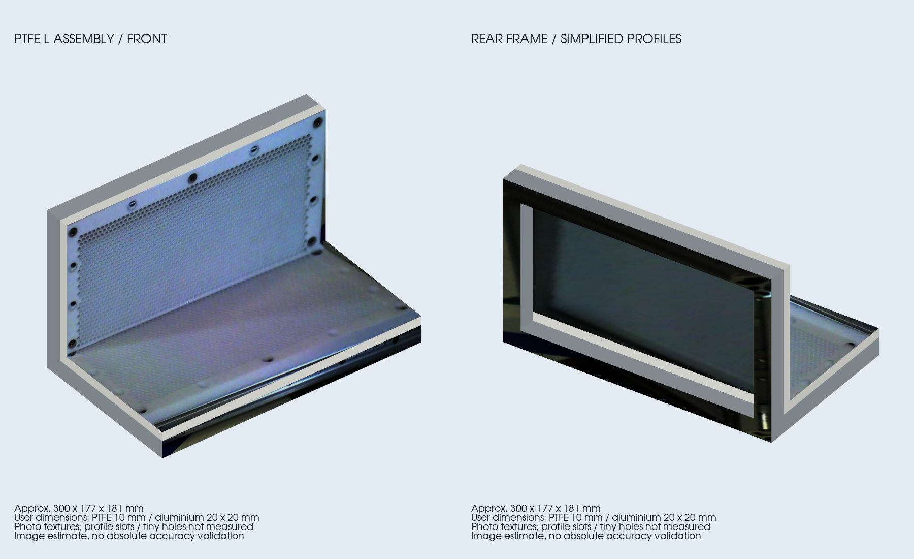

# PTFE-L-Konstruktion als separates Asset

Stand 13.11.2026: mit vier Wristkameras und OAK aufgenommen, ohne Armbewegung.
Asset-ID **`ptfe_l_assembly_v1`**, Verzeichnis
`uwa_cell_description/assets/ptfe_l_assembly_v1/`.



## Maße und Modellgrenzen

| Größe | Wert | Herkunft |
|---|---:|---|
| Aluminiumprofile | 20 × 20 mm | Nutzerangabe, nicht nachgemessen |
| PTFE-Plattenstärke | 10 mm | Nutzerangabe, nicht nachgemessen |
| Außenbreite | ca. 300 mm | Mehransichts-Schätzung |
| Außentiefe | ca. 177 mm | Mehransichts-Schätzung |
| Außenhöhe | ca. 181 mm | Mehransichts-Schätzung |

Zwei rechtwinklige Platten und sieben vereinfachte Profilkörper. Die sichtbaren
Oberflächen sind echte entzerrte Fototexturen; Schrauben, kleine Bohrungen und
Profilnuten sind **nur in der Textur**, nicht als vermessene CAD-Details enthalten.
Die verdeckte Unterseite und Profilanordnung sind teilweise angenommen. Eine
verdeckte 0,1-mm-CAD-Fuge verhindert eine nichtmanifold Linienberührung zwischen
hinterem Träger und Bodenplatte; sie ist keine gemessene Eigenschaft.

Der Ursprung liegt hinten unten, +Z nach oben; die Breite verläuft entlang +X,
die liegende Platte entlang +Y. Das Manifest enthält eine geschätzte Pose relativ
zum rechten ChArUco-Board. Sie ist keine unabhängig vermessene Weltposition.

## Dateien und Verwendung

- `model.step`: vereinfachter CAD-Körper, **Millimeter**.
- `model.stl`: geschlossenes Geometrienetz, **Meter**.
- `model.glb`: texturiertes Modell, **Meter**, eingebettete Texturen.
- `model.dae` und `textures/`: portable ROS-/Gazebo-Darstellung in **Metern**.
- `asset.json`: eigene Objekt-ID, Maße, Frame, Quellen- und Ressourcenhashes.

Das Asset ist installiert, aber noch nicht als zusätzliche aktive Szeneinstanz
eingetragen. Die laufende Karton-Greif-/Planungsarbeit wird dadurch nicht geändert.
Eine spätere `scene_objects`-Instanz kann das Asset über denselben Loader wie den
Karton laden; dieser prüft Hashes und berechnet Gazebo-/TF-/RViz-Pose gemeinsam.
Es wird dadurch kein Kollisionskörper oder Physikmodell automatisch aktiviert.

## Aufnahme und geometrische Prüfung

Alle lokalen Rohdaten unter `setup/digitization/ptfe_l_20261113/`, nicht im Git:

- Erfolgreiches Set:
  `acquisition/20261113_153425_f9234640/set_153436_409595/manifest.json`.
- Vier Wristbilder mit 2592×1944 und OAK mit 8000×6000 Pixeln;
  alle fünf Bilder aufgenommen und mit mindestens zwölf Boardecken brauchbar.
  Nicht alle Boards sind vollständig sichtbar: `all_full:false` bleibt erhalten.
- Durchgehender Stillstand aller vier Arme bestätigt, maximale Gelenkabweichung
  über den Fotoablauf 0,000137 rad. Ausschließlich lesende RTDE-Ausgaben, keine
  Treiber-, Power-, Brake-, Play- oder Fahrbefehle.
- Der erste Versuch ohne vorhandene ROS-Gelenktelemetrie wurde vor Wristfotos
  abgebrochen und bleibt als Fehlschlag gespeichert. Für den zweiten Versuch
  wurde ausdrücklich `--telemetry-source rtde` verwendet; keine Prüfgrenze wurde
  gelockert. Fokuswiederherstellung in der Sitzung gespeichert.

Eigene native Fokus-K/D je Kamera bleiben fest. Geometriefit mit OAK, hinten
links und hinten rechts; vorne rechts nur geometrische Prüfung. Vorne links
wegen auffälliger nativer Board-Reprojektion aus der metrischen Schätzung
ausgeschlossen. Keine alte Kartongeometrie, nominellen Roboterbasen oder
bekannte Objektpose als Fitprior verwendet.

Restfehler der manuell zugeordneten Objektpunkte bei 1600 Pixel Vorschau-Breite:
OAK 5,70 px, hinten links 13,72 px, hinten rechts 12,99 px; vorne rechts als
Prüfansicht **25,20 px**. Diese sichtbaren systematischen Abweichungen bleiben
erhalten. Das Ergebnis ist ein erstes Bildmodell, **keine bestätigte
Millimetergenauigkeit**. Optik, Eckzuordnung und vereinfachte Geometrie sind
noch mögliche Fehlerquellen.

Exportprüfung: STEP wieder eingelesen, Maße geprüft; STL geschlossen, ein
zusammenhängender Körper, konsistente Orientierung und positives Volumen;
GLB/DAE haben dieselben Außenmaße. 116 Dreiecke, fünf Fototexturflächen.
Nachweise: `reconstruction/assembly_result.json`, `reconstruction/cad/export.json`,
`tests.log` und `build.log`. 21 gezielte Tests bestanden, beide betroffenen
Pakete gebaut. Die Vorschau wurde von beiden Seiten visuell geprüft.

## Tracking: vorbereitet, Wiedererkennung noch offen

Die bisherige CPU-Pipeline kann das Asset unverändert einlesen. Referenz unter
`setup/tracking/models/ptfe_l_assembly_v1/reference.npz`, **1494 Merkmale** auf fünf
texturierten Flächen; keine gespeicherte Board-/Objektpose zur Initialisierung.

```bash
bash src/multi_arm_manipulation_UWA/scripts/object_tracking.sh prepare ptfe_l_assembly_v1
# Kamera-only, startet IDLE; kein Roboterbefehl:
bash src/multi_arm_manipulation_UWA/scripts/object_tracking.sh oak ptfe_l_assembly_v1
```

**Noch kein erfolgreicher Trackingnachweis für dieses Objekt:** globale
Offline-Lokalisierung in OAK, hinten links, hinten rechts und vorne rechts
meldet jeweils `LOST`; es wird keine vermeintlich gültige Pose ausgegeben.
Der periodische Lochraster, glatte Rückseite und wenig eindeutige Struktur
erschweren die texturbasierte Zuordnung. Eine zusätzliche versuchsweise
mehrskalige Referenz ergab ebenfalls keinen Erfolg und wurde nicht als neuer
Standard übernommen; Diagnosen bleiben unter `multiscale_*/` erhalten.

Das Modell steht somit für den nächsten Tracking-Schritt bereit. Dafür sind
zusätzliche eindeutige Oberflächenmerkmale oder ein Backend mit Kontur-/Tiefen-
information zu prüfen. Weder Onlineverfolgung noch absolute Posegenauigkeit
sind hier bestätigt; die frühere Karton-Erfolgsrate gilt nicht automatisch.

## Offline reproduzieren

Gespeicherte Aufnahme und native Optikmodelle werden benötigt; diese Befehle
öffnen keine Kamera und bewegen keinen Arm:

```bash
source src/multi_arm_manipulation_UWA/scripts/control_env.bash
python3 src/multi_arm_manipulation_UWA/tools/reconstruct_ptfe_l.py \
  --output setup/digitization/ptfe_l_20261113/reconstruction
python3 src/multi_arm_manipulation_UWA/tools/texture_ptfe_l.py \
  --root setup/digitization/ptfe_l_20261113
.venvs/oak-model/bin/python src/multi_arm_manipulation_UWA/tools/export_ptfe_l_asset.py \
  --root setup/digitization/ptfe_l_20261113 \
  --asset src/multi_arm_manipulation_UWA/uwa_cell_description/assets/ptfe_l_assembly_v1
```

Nach einem neuen Export Trackingreferenz neu erzeugen, weil sie an den
Manifesthash gebunden ist. VTK-Vorschau in einer frischen Shell mit CAD-Venv
starten; eine durch ROS veränderte Bibliotheksumgebung führte einmal zu einem
Rendererabsturz, nicht zu einer beschädigten Modelldatei.
